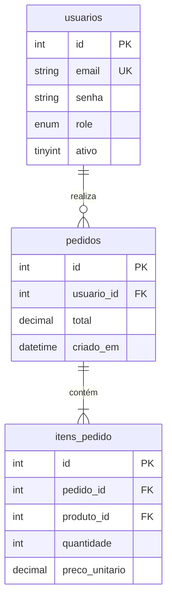

# Documentação Técnica

## Princípios

- Documentar o **porquê**, não o **o quê** (o código já mostra o quê)
- Manter próxima do código (mesma PR que a mudança)
- Preferir documentação curta e precisa a longa e desatualizada
- Nunca incluir segredos, senhas ou dados de produção em documentação versionada

---

## README.md — estrutura padrão

```markdown
# Nome do Sistema

Descrição em 1–2 frases: o que é, para quem serve e qual problema resolve.

## Requisitos

- PHP 8.1+
- MySQL 8.0+
- Composer 2.x

## Instalação

```bash
git clone https://github.com/org/repo.git
cd repo
composer install
cp .env.example .env
# Preencher .env com as credenciais do ambiente
php setup/migrate.php
```

## Configuração

| Variável | Descrição | Exemplo |
|----------|-----------|---------|
| `DB_HOST` | Host do banco | `127.0.0.1` |
| `SMTP_HOST` | Servidor SMTP | `smtp.exemplo.com` |

## Estrutura do projeto

```
core/       roteador, controller base, view, conexão PDO
config/     constantes e bootstrap
modulos/    funcionalidades (um subdiretório por módulo)
public/     único diretório exposto pelo servidor web
```

## Testes

```bash
./vendor/bin/phpunit
./vendor/bin/phpunit --coverage-html coverage/
```

## Deploy

Ver [docs/deploy.md](docs/deploy.md).

## Licença

[MIT](LICENSE)
```

---

## ADR — Architecture Decision Record

Registrar **toda decisão técnica relevante** que não seja óbvia pelo código.

```markdown
# ADR-001: Autenticação via sessão PHP em vez de JWT

**Data:** 2026-06-04
**Status:** Aceito

## Contexto

Sistema web com front-end PHP renderizado no servidor. Usuários autenticam
via formulário e navegam por múltiplas páginas na mesma sessão.

## Decisão

Usar sessões PHP nativas (`session_start`) com cookies `HttpOnly; Secure; SameSite=Strict`.

## Motivos

- JWT agrega complexidade (refresh token, revogação) sem benefício para este caso de uso
- Sessões PHP são suficientes para aplicações server-side sem API pública
- Revogação imediata ao fazer logout (JWT exigiria blacklist)

## Consequências

- Escalar horizontalmente requer sessões compartilhadas (Redis/banco) — aceitável no escopo atual
- API futura precisará de token (JWT ou API key) — criar novo ADR quando necessário

## Alternativas consideradas

- JWT stateless: descartado pela complexidade de revogação
- OAuth2: desnecessário sem login social no escopo atual
```

Nomear arquivos: `docs/adr/001-autenticacao-sessao.md`

---

## PHPDoc — quando e como usar

Documentar **funções públicas não óbvias**, parâmetros com tipos complexos e exceções lançadas.

```php
/**
 * Envia e-mail de redefinição de senha com token de uso único.
 *
 * O token é gerado externamente e deve ser armazenado como hash SHA-256
 * antes de chamar esta função. TTL máximo recomendado: 1 hora.
 *
 * @param string $email   Endereço validado do destinatário
 * @param string $token   Token em claro (será incluído no link, não armazenado aqui)
 * @return bool           true se enviado com sucesso, false em caso de falha de SMTP
 * @throws InvalidArgumentException  Se o e-mail não for válido
 */
function enviar_reset_senha(string $email, string $token): bool
```

**Não documentar** o óbvio:
```php
// ❌ desnecessário
/** Retorna o id do usuário */
function getId(): int { return $this->id; }
```

---

## Comentários no código

```php
// ✅ Explica decisão não óbvia
// Usar hash_equals para prevenir timing attacks na comparação de tokens
if (!hash_equals($tokenEsperado, $tokenRecebido)) { ... }

// ✅ Explica limitação conhecida
// LIMIT 1000 temporário — substituir por paginação quando volume crescer (issue #87)
$stmt = $pdo->prepare("SELECT id, nome FROM logs ORDER BY criado_em DESC LIMIT 1000");

// ❌ Repete o código — remover
// Busca usuário por email
$stmt = $pdo->prepare("SELECT * FROM usuarios WHERE email = :email");
```

---

## CHANGELOG.md

Seguir [Keep a Changelog](https://keepachangelog.com/pt-BR/):

```markdown
# Changelog

## [Não lançado]
### Adicionado
- Módulo de relatórios com exportação CSV

## [1.2.0] — 2026-06-04
### Adicionado
- Rate limiting no endpoint de login (5 tentativas / 15 min)
### Corrigido
- Validação de MIME em uploads aceitava extensão em vez de conteúdo real
### Segurança
- Token de reset agora armazenado como hash SHA-256 (era texto claro)

## [1.1.0] — 2026-05-10
### Adicionado
- Autenticação com 2FA via TOTP
```

---

## .env.example

```ini
# Banco de dados
DB_HOST=127.0.0.1
DB_PORT=3306
DB_NAME=nome_do_banco
DB_USER=usuario
DB_PASS=

# Aplicação
APP_ENV=development
APP_URL=http://localhost
APP_DEBUG=true
APP_TIMEZONE=America/Sao_Paulo

# SMTP
SMTP_HOST=
SMTP_PORT=587
SMTP_USER=
SMTP_PASS=
MAIL_FROM=noreply@exemplo.com
MAIL_FROM_NAME="Nome do Sistema"
```

Regras:
- Incluir **todas** as variáveis necessárias, sem valores reais
- Comentar o propósito de variáveis não óbvias
- Manter sincronizado com `.env` real (atualizar na mesma PR)

---

## Guia de onboarding (`docs/onboarding.md`)

Estrutura mínima para novos desenvolvedores:

```markdown
# Onboarding — Desenvolvimento Local

## 1. Pré-requisitos
## 2. Configuração do ambiente (passo a passo)
## 3. Executar testes
## 4. Convenções do projeto (links para ADRs, git-workflow)
## 5. Onde pedir ajuda
```

---

## Documentação de banco de dados (`docs/banco/`)

### Dicionário de dados (`docs/banco/dicionario.md`)

Descrever cada tabela e suas colunas. Atualizar na mesma PR que altera o schema.

```markdown
## Tabela: `usuarios`

Armazena os usuários autenticados do sistema.

| Coluna | Tipo | Nulo | Padrão | Descrição |
|--------|------|------|--------|-----------|
| `id` | INT UNSIGNED | Não | AUTO_INCREMENT | Chave primária |
| `nome` | VARCHAR(100) | Não | — | Nome completo do usuário |
| `email` | VARCHAR(255) | Não | — | E-mail único; usado para login |
| `senha` | VARCHAR(255) | Não | — | Hash bcrypt (nunca armazenar em claro) |
| `role` | ENUM | Não | `usuario` | Papel: `admin` ou `usuario` |
| `ativo` | TINYINT(1) | Não | `1` | Soft-enable; `0` = acesso bloqueado |
| `criado_em` | DATETIME | Não | `CURRENT_TIMESTAMP` | Data de cadastro |
| `atualizado_em` | DATETIME | Não | `CURRENT_TIMESTAMP` | Última atualização |

**Índices:** `UNIQUE (email)`
**Relacionamentos:** referenciada por `pedidos.usuario_id`, `log_auditoria.usuario_id`
**Observações:** exclusão lógica via `ativo = 0`; nunca deletar registro de usuário.
```

### Diagrama ER (`docs/banco/diagrama.md`)

Usar Mermaid para representar o relacionamento entre tabelas:

```markdown

```

### Registro de migrations (`docs/banco/migrations.md`)

Histórico das alterações de schema, além do controle automatizado:

```markdown
| Migration | Data | Descrição | Autor |
|-----------|------|-----------|-------|
| `2026_06_04_100000_criar_tabela_usuarios` | 2026-06-04 | Schema inicial | — |
| `2026_06_04_110000_adicionar_telefone_usuarios` | 2026-06-04 | Campo opcional de contato | — |
```

### Boas práticas

- Atualizar o dicionário e o diagrama **na mesma PR** que altera o schema
- Nunca incluir dados reais de produção em exemplos de documentação (LGPD)
- Registrar decisões de modelagem relevantes como ADR (ex: motivo de usar soft delete)

---

## Nunca documentar

- Senhas, tokens ou chaves reais (nem em exemplos)
- Código comentado sem justificativa (`// TODO` sem issue vinculada)
- Documentação duplicada que diverge do código — manter uma fonte de verdade
